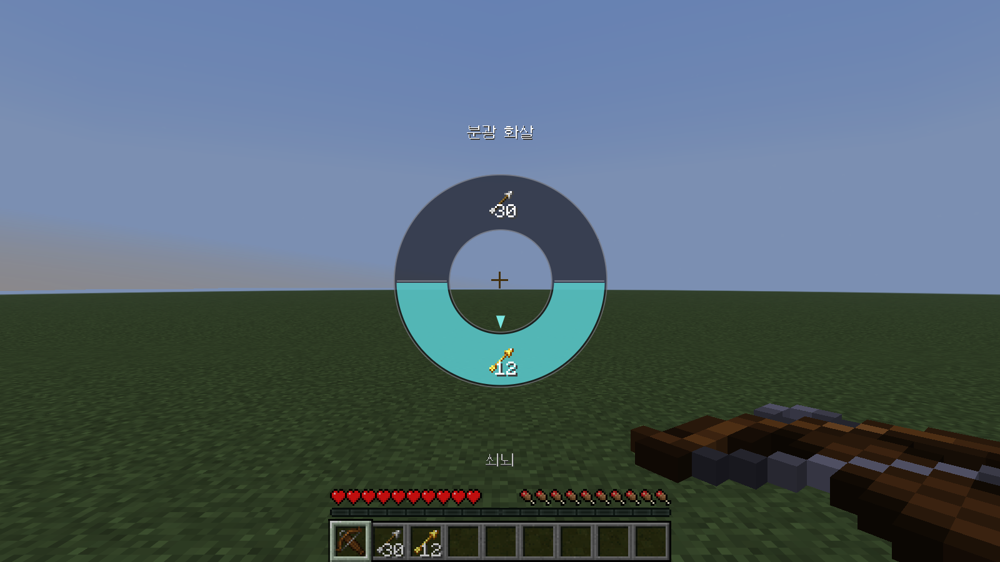

# QuantumArrows

Minecraft **26.3** Fabric 클라이언트 모드 — 활(또는 쇠뇌)을 든 채 **휠 클릭**하면 가지고 있는 화살 종류를
원형 GUI로 띄우고, 마우스를 원하는 화살 방향으로 옮긴 뒤 **휠을 놓으면** 그 화살을 지정한 칸
(기본값: 인벤토리 **맨 윗줄 2번째 칸**)으로 옮깁니다.

| 방향 선택 | 8종류 이상: 오른쪽 `>` 로 페이지 넘김 | 정리 불가 경고 |
|---|---|---|
|  |  |  |

| 모드 메뉴 설정 화면 | 키 설정(Controls) 메뉴 | 쇠뇌 |
|---|---|---|
|  |  |  |

## 설치

1. [Fabric Loader](https://fabricmc.net/use/) 0.19.5 이상과 Fabric API(26.3용)를 설치합니다.
2. [Releases](../../releases/latest) 에서 최신 `quantumarrows-<버전>.jar` 를 받아 `.minecraft/mods/` 에 넣습니다
   (변경 내용은 [릴리즈 노트](docs/RELEASE_NOTES_1.0.1.md)).
3. (선택) 설정 화면을 쓰려면 [Mod Menu](https://modrinth.com/mod/modmenu) 21.0.0 이상(26.3용)도 설치합니다.
   없어도 모드는 동작하고, 키는 키 설정 메뉴에서 바꿀 수 있습니다.

## 동작

- **휠 키(기본: 휠 클릭)** 를 누르고 있으면 휠이 열립니다. 이 키는 `설정 > 조작 > 키 설정`의 *QuantumArrows* 항목과
  Mod Menu의 모드 설정 화면, 두 곳에서 바꿀 수 있고 서로 같은 설정입니다.
- 발동 조건은 Mod Menu 설정 화면에서 고릅니다.
  - `HOLD ON BOW` (기본): 활/쇠뇌를 주손 또는 보조손에 들고 있을 때만 열립니다. 활이 없으면 키는 원래 기능
    (휠 클릭이면 바닐라 블록 선택)을 그대로 합니다.
  - `EVERYTHING`: 무엇을 들고 있든 항상 열립니다. 활/쇠뇌가 없으면 일반 화살 기준으로 보여 줍니다.
  - `DISABLE`: 휠을 사용하지 않습니다. 키는 원래 기능만 합니다.
  - 휠이 열릴 때는 같은 버튼에 묶인 바닐라 블록 선택은 동작하지 않습니다.
- **활 자동 발사** (기본 켜짐): 활을 주손에 든 상태에서 **좌클릭** 으로 활 당김 단계를 다룹니다.
  - 좌클릭을 **짧게 한 번** 누르면 단계가 하나씩 바뀝니다 (1/4 → 2/4 → 3/4 → 4/4 → 다시 1/4). 바뀐 단계는 화면 아래에 표시됩니다.
  - 좌클릭을 **꾹 누르고 있으면**(3틱, 0.15초 이상) 정한 단계까지 당겼다가 쏘기를 계속 반복합니다. 버튼을 떼면 지금 당기던 한 발까지만 쏘고 멈춥니다.
  - 단계별 당김은 1단계 15%(3틱, 활이 나가는 최소 당김), 2단계 50%, 3단계 75%, 4단계 100%(1초) 입니다.
  - 이 기능이 켜져 있으면 활을 든 동안 좌클릭의 원래 기능(공격, 블록 부수기)은 동작하지 않습니다. 필요 없으면 설정에서 끄세요.
  - 화살이 없으면 발사하지 않습니다.
- **쇠뇌 지원**: 활과 똑같이 쇠뇌를 들었을 때도 휠이 열리고, 고른 화살이 쇠뇌에 장전됩니다.
- **쇠뇌 자동 장전** (기본 켜짐): 쇠뇌는 우클릭을 계속 누르고 있으면 충전이 끝난 뒤에도 마지막 장전 모션에 멈춰 있습니다.
  이 설정이 켜져 있으면 충전이 끝나는 순간 자동으로 우클릭을 놓은 것으로 처리해서 장전을 끝냅니다.
  버튼을 계속 누르고 있어도 장전된 쇠뇌가 바로 발사되지는 않고, 다시 눌러야 발사됩니다.
- **왼손 활 인정** (기본 켜짐): `HOLD ON BOW` 에서 보조손(왼손)에 든 활/쇠뇌도 발동 조건으로 인정합니다. 끄면 주손에 든 활만 인정합니다.
- 화살은 종류별로 묶어서 보여 줍니다 (일반 / 분광 / 물약 종류별 화살은 각각 따로, 총 개수 표시).
  1000개 이상은 `1.2K`처럼 줄여서 표시합니다.
- **7종류 이하**는 한 화면에 고정된 순서로 보이고, **8종류 이상**이면 인벤토리 순서대로 한 페이지에 7개씩 보입니다.
  오른쪽의 `>` 칸에 마우스를 가져가면 다음 페이지로 넘어갑니다 (마지막 페이지 다음은 첫 페이지, 가운데에 `1/3` 식으로 표시).
- 가운데 데드존 밖으로 마우스를 옮긴 방향의 칸이 반투명한 하늘~민트색으로 강조됩니다.
  휠을 놓으면 확정되고, 가운데에서 놓으면 아무것도 바뀌지 않습니다. 좌클릭으로도 확정할 수 있습니다.
- 휠 그래픽(링, 선택 부채꼴, 구분선)은 벡터(SDF)로 화면 실제 해상도에서 안티에일리어싱해 계산하므로
  GUI 배율과 상관없이 매끄럽습니다. 계산은 백그라운드 스레드에서 한 번만 하고 텍스처로 구워 두기 때문에
  휠을 열거나 칸을 바꿔도 끊기지 않습니다 (준비되기 전 아주 잠깐은 링이 안 보일 수 있습니다).
- 휠 아래(핫바 위)에는 **변경될 대상 칸에 지금 들어 있는 아이템**이 아이콘 + 이름(+개수)으로 표시됩니다.
  칸이 비어 있으면 표시되지 않습니다.
- 선택한 화살 중 가장 큰 묶음이 대상 칸으로 이동하고, 대상 칸에 있던 아이템은 화살이 있던 자리로 바뀝니다.
  (일반 인벤토리 클릭 패킷을 쓰므로 서버 쪽 모드 없이 멀티플레이에서도 동작합니다.)
- **앞쪽 화살 정리**: 활은 보조손 → 핫바/인벤토리 앞 칸 순으로 화살을 쓰므로, 대상 칸보다 앞(보조손 포함)에 있는
  다른 화살은 대상 칸 뒤쪽의 빈 칸으로 옮겨 정리합니다. 그래서 고른 화살이 실제로 발사됩니다.
- 뒤쪽 빈 칸이 부족해 정리할 수 없으면, 해당 화살에 마우스를 올렸을 때 휠 위에 **경고**가 뜨고
  정리 없이 대상 칸으로만 이동합니다.

## 설정

`config/quantumarrows.json` (처음 실행 시 생성)

```json
{
  "targetSlot": 10,
  "activation": "HOLD_ON_BOW",
  "offhandBow": true,
  "autoLoadCrossbow": true,
  "autoFireBow": true,
  "fireStage": 4
}
```

`activation` 은 `HOLD_ON_BOW`, `EVERYTHING`, `DISABLE` 중 하나이며 `offhandBow`, `autoLoadCrossbow`, `autoFireBow` 는 `true`/`false`, `fireStage` 는 1~4 입니다. 둘 다 Mod Menu 설정 화면에서도 바꿀 수 있습니다.

| 값 | 위치 |
|---|---|
| 0–8 | 핫바 1–9번째 칸 |
| 9–17 | 인벤토리 맨 윗줄 (10 = 2번째 칸, 기본값) |
| 18–26 | 가운데 줄 |
| 27–35 | 맨 아랫줄 |
| 40 | 보조손 |

## 빌드 (Maven)

필요: **JDK 25**, **Maven 3.9+**

```sh
mvn package
```

결과물: `mod/target/quantumarrows-<버전>.jar`

### 릴리즈

`.github/release-version` 파일의 내용(예: `1.0.1`)을 바꿔서 푸시하면 GitHub Actions(`.github/workflows/release.yml`)가
JDK 25 로 빌드해서 `v1.0.1` 태그와 jar 가 첨부된 릴리즈를 만듭니다. `v1.0.1` 같은 태그를 직접 푸시하거나
Actions 탭에서 수동 실행해도 됩니다. 이미 있는 버전의 릴리즈는 다시 만들지 않습니다. 릴리즈 본문은 `docs/RELEASE_NOTES_<버전>.md` 가 있으면 그것을 씁니다.
(버전을 올릴 때는 `pom.xml` 의 `version` 도 같이 올려 주세요.)

### 구조

Minecraft 26.x 는 난독화가 풀린 상태로 배포되므로 Loom/리매핑 없이 바닐라 클라이언트 jar 에 바로 컴파일합니다.

- `minecraft/` — Mojang 서버에서 26.3 `client.jar` 를 받아(SHA-1 검증) reactor 아티팩트로 붙여 주는 모듈
- `mod/` — 실제 모드 소스

다른 26.x 버전으로 옮기려면 루트 `pom.xml` 의 `minecraft.version`, 클라이언트 jar URL/SHA-1,
Fabric 버전들과 `mod/src/main/resources/fabric.mod.json` 의 `minecraft` 범위를 바꾸세요.
