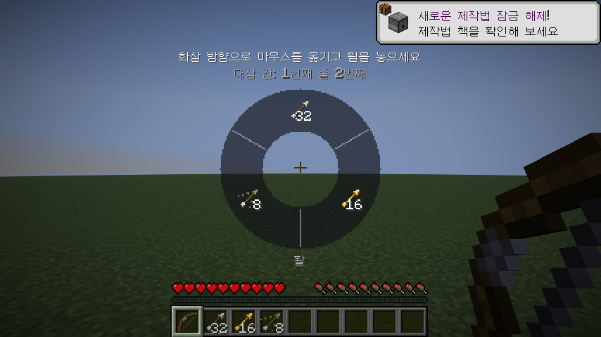
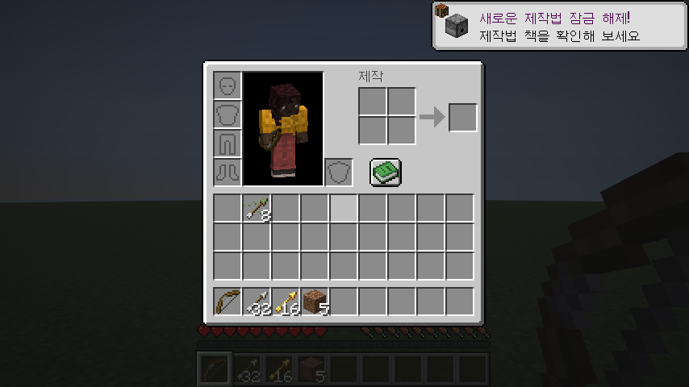

# QuantumArrows

Minecraft **26.3** Fabric 클라이언트 모드 — 활(또는 쇠뇌)을 든 채 **휠 클릭**하면 가지고 있는 화살 종류를
원형 GUI로 띄우고, 마우스를 원하는 화살 방향으로 옮긴 뒤 **휠을 놓으면** 그 화살을 지정한 칸
(기본값: 인벤토리 **맨 윗줄 2번째 칸**)으로 옮깁니다.

| 휠을 누름 | 방향 선택 | 놓은 뒤 인벤토리 |
|---|---|---|
|  |  |  |

## 동작

- 활/쇠뇌를 주손 또는 보조손에 들고 **선택 블록 키(기본: 휠 클릭)** 를 누르고 있으면 휠이 열립니다.
  활을 들고 있을 때는 바닐라 블록 선택이 동작하지 않고, 활이 없을 때는 원래대로 동작합니다.
- 화살은 종류별로 묶어서 보여 줍니다 (일반 / 분광 / 물약 종류별 화살은 각각 따로, 총 개수 표시).
- 가운데 데드존 밖으로 마우스를 옮긴 방향의 칸이 선택되고, 휠을 놓으면 확정됩니다.
  가운데에서 놓으면 아무것도 바뀌지 않습니다. 좌클릭으로도 확정할 수 있습니다.
- 선택한 화살 중 가장 큰 묶음이 대상 칸으로 이동하고, 대상 칸에 있던 아이템은 화살이 있던 자리로 바뀝니다.
  (일반 인벤토리 클릭 패킷을 쓰므로 서버 쪽 모드 없이 멀티플레이에서도 동작합니다.)

> 참고: 바닐라 활은 보조손 → 주손 → 핫바 → 인벤토리 순으로 화살을 씁니다.
> 핫바에 다른 화살이 있으면 그쪽이 먼저 쓰이니, 대상 칸을 핫바로 바꾸고 싶다면 아래 설정을 쓰세요.

## 설정

`config/quantumarrows.json` (처음 실행 시 생성)

```json
{
  "targetSlot": 10
}
```

| 값 | 위치 |
|---|---|
| 0–8 | 핫바 1–9번째 칸 |
| 9–17 | 인벤토리 맨 윗줄 (10 = 2번째 칸, 기본값) |
| 18–26 | 가운데 줄 |
| 27–35 | 맨 아랫줄 |
| 40 | 보조손 |

## 빌드 (Maven)

필요: **JDK 25**, **Maven 3.9+**

```sh
mvn package
```

결과물: `mod/target/quantumarrows-1.0.0.jar` → `.minecraft/mods/`에 넣고,
[Fabric Loader](https://fabricmc.net/use/) 0.19.5+ 와 Fabric API(26.3용)를 함께 설치하세요.

### 구조

Minecraft 26.x 는 난독화가 풀린 상태로 배포되므로 Loom/리매핑 없이 바닐라 클라이언트 jar 에 바로 컴파일합니다.

- `minecraft/` — Mojang 서버에서 26.3 `client.jar` 를 받아(SHA-1 검증) reactor 아티팩트로 붙여 주는 모듈
- `mod/` — 실제 모드 소스

다른 26.x 버전으로 옮기려면 루트 `pom.xml` 의 `minecraft.version`, 클라이언트 jar URL/SHA-1,
Fabric 버전들과 `mod/src/main/resources/fabric.mod.json` 의 `minecraft` 범위를 바꾸세요.
